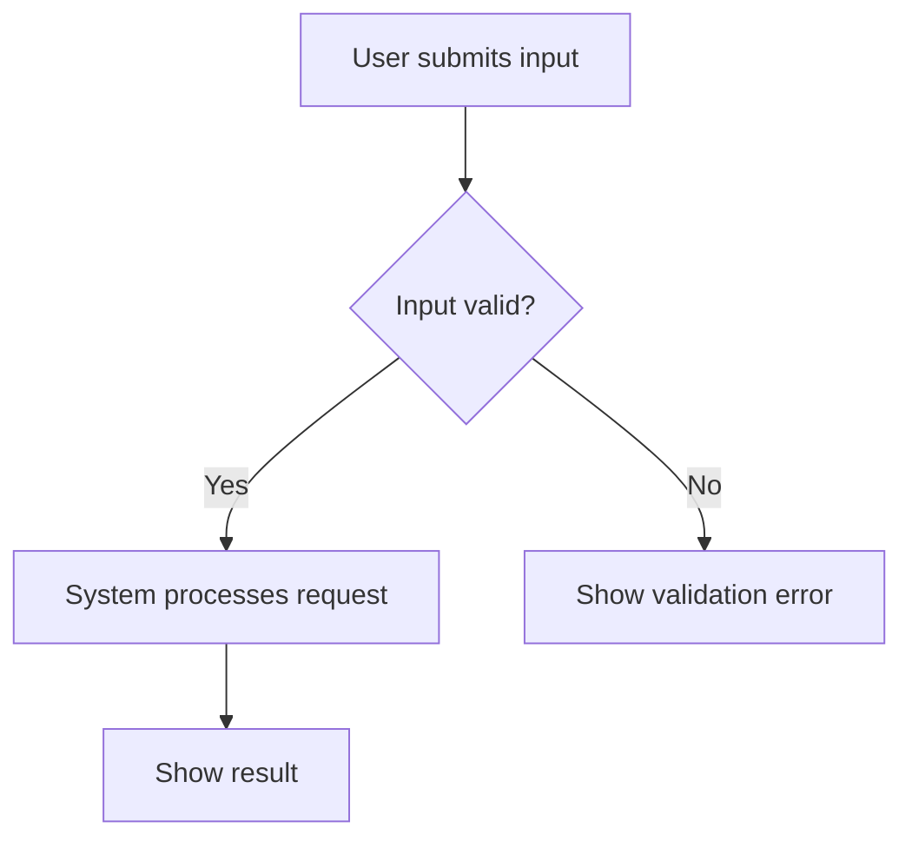

# Taidev Operation Flow

Add a readable Mermaid operation flow to the change's planning documents. This
describes the requested feature, not the propose/apply/verify/archive lifecycle.
This skill edits planning documents only; it never implements or runs the feature.

## Inputs

Use the selected change, resolved artifact paths from OpenSpec, and the understood
user request. When invoked independently, resolve the change and paths with
`openspec status --change "<name>" --json`, preserving any selected `--store`.
If the change is ambiguous, ask the user. Never create a change as a side effect.

## Procedure

1. Re-read the proposal, available delta specs, and design from disk. Use existing
   main specs only for unchanged behavior needed to understand the operation.
   Respect skipped artifacts; do not create specs or invent requirements.
2. Identify the actor or trigger, input, user actions, system responses, decisions,
   and terminal outcomes. Cover the main success path and specified validation,
   failure, cancellation, or retry paths. Do not invent branches or retry policies.
   Ask about material gaps; label minor assumptions in the surrounding text.
3. Insert or update one `## Operation Flow` section in the resolved design file,
   after Goals / Non-Goals and before Decisions. Preserve all other sections and
   user edits. If design was deliberately skipped or the schema has no design,
   use the resolved proposal instead; never create a skipped design. If neither
   document is available, report the blocker rather than writing elsewhere.
4. Use a fenced `mermaid` block with `flowchart TD`. Use short ASCII node IDs,
   quoted human-readable labels, and labeled decision edges. Follow the user's
   document language (Traditional Chinese when the request is in Traditional
   Chinese). Separate large independent journeys into titled diagrams.
5. Add a short explanation of the entry condition, outcomes, and key branches.
   Associate branches with spec scenario names when available, so readers can
   compare the diagram with acceptance criteria. The diagram supplements the
   specs; it does not replace them or claim the feature is already implemented.
6. Verify the saved document contains the section and Mermaid fence, all paths
   reach an outcome or an explicitly specified loop, decision edges are labeled,
   and the diagram agrees with the latest specs and text. Render or parse it with
   existing local Mermaid tooling when available; fix errors before finishing.
   If tooling is unavailable, perform structural checks and explicitly report
   that rendering was not verified. Never send project content to online renderers.
   On repeat invocation, update the existing section instead of appending a duplicate.

## Syntax Example

Adapt this example to the actual requirement; do not copy its behavior blindly.

