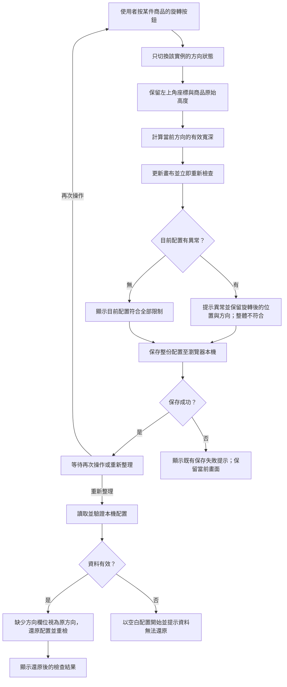

# Design｜商品手動旋轉 90 度

## Context

動機與上游決策見 [proposal.md](proposal.md)。目前 `Placement` 只保存商品 ID 與左上角座標；`layoutReducer` 沒有旋轉動作；`validateLayout` 與 SVG 畫布都直接讀取商品原始寬深。本機資料透過 Zod 驗證後存入 `fit-space:layout:v1`，舊配置沒有方向欄位。幾何比較使用 0.01 cm 整數單位，既有 40 筆固定案例以原方向檢查。

## Goals / Non-Goals

**Goals:**

- 讓同一實例的畫布矩形、拖曳幾何與檢查共用一個「當前方向的有效寬深」計算，避免畫面和判定不同步。
- 讓舊版配置及原有 40 筆品質案例繼續以原方向解讀；旋轉欄位只屬於配置實例，不改動商品資料。
- 讓旋轉動作走現有狀態更新、重檢與本機保存流程。

**Non-Goals:**

- 建立通用角度或變形系統；本次方向只有原方向和 90 度兩種狀態。
- 修改商品目錄或增加自動排列演算法。

## Operation Flow

入口是使用者已放入商品，並按該實例的「旋轉」按鈕。正常路徑對應「逐件切換且左上角不變」及「轉向後尺寸與高度分別判定」；異常分支對應「旋轉造成異常仍保留」與「旋轉產生與解除異常」。重新整理分支對應「旋轉狀態重新整理後保留」及「舊版保存資料維持原方向」。

## Decisions

1. **方向存於 `Placement` 的可選布林欄位 `rotated?: boolean`。** 缺欄位等於 `false`，新放入商品明確寫入 `false`，按鈕只切換目標實例。這可讓舊本機資料及原 40 筆品質案例不修改即可使用。曾考慮必填欄位並遷移所有既有資料，但會讓舊 fixture 與本機配置多一道格式轉換。Zod 只接受布林值；非布林值視為損毀資料。
2. **集中計算有效平面尺寸。** 用純函式由商品原始寬深與實例方向算出寬深，畫布尺寸、拖曳定位與 `validateLayout` 都使用它；高度一律取商品原始值。沿用現行 0.01 cm 整數比較，因此貼齊仍合法。曾考慮在旋轉時改寫商品尺寸或各處分別交換欄位，前者會污染商品目錄與其他實例，後者容易造成顯示和檢查不一致。
3. **沿用 reducer 與現有保存鍵。** 加入 `rotate` 動作，既有 `dispatch → saveLayout → validateLayout` 流程處理自動重檢與保存，不建立第二套旋轉狀態。舊資料缺欄位可直接解析；未來保存時寫入目前狀態。曾考慮改用新鍵並搬移資料，但這次沒有破壞性格式變更，搬移會增加遺失配置的風險。
4. **每個已放入實例的清單控制區提供「旋轉」按鈕。** 按鈕與實例 ID 綁定，避免同商品不同實例一起轉動；SVG 仍從配置狀態繪製矩形。曾考慮只在畫布上提供手勢，但清單按鈕對鍵盤與瀏覽器測試較明確，也符合指定互動。

## Risks / Trade-offs

- [畫布、拖曳或驗證漏用有效尺寸] → 集中純函式並以獨立旋轉固定案例、瀏覽器案例檢查三者一致。
- [舊配置缺方向欄位或方向欄位無效] → 缺欄位預設原方向；非布林值由 Zod 拒絕並沿用空白配置與提示行為。
- [旋轉造成越界或重疊] → 允許保留實例，立即產生異常；任何異常都不得顯示「符合全部限制」。
- [現行規格名稱與 Purpose 含「固定方向」字樣] → Delta 保留既有 Requirement 名稱以確保 `MODIFIED` 能對應；套用與封存時同步調整主規格說明，使正文清楚表達「放入時原方向、可手動旋轉」。

## Migration Plan

1. 加入可選方向欄位與 `rotate` 動作，沿用現有本機鍵；舊資料直接視為未旋轉。
2. 接上有效尺寸、畫布、拖曳與驗證；補旋轉專用固定案例、瀏覽器案例，並調整舊 E2E 中「沒有旋轉」的過時斷言。原 40 筆 fixture 保持原樣。
3. 套用或封存規格時，同步更新主規格中舊的固定方向說明及產品文件。若需回退程式，舊版讀取器會忽略新欄位並以原方向呈現，已旋轉的方向不會在舊版呈現。
