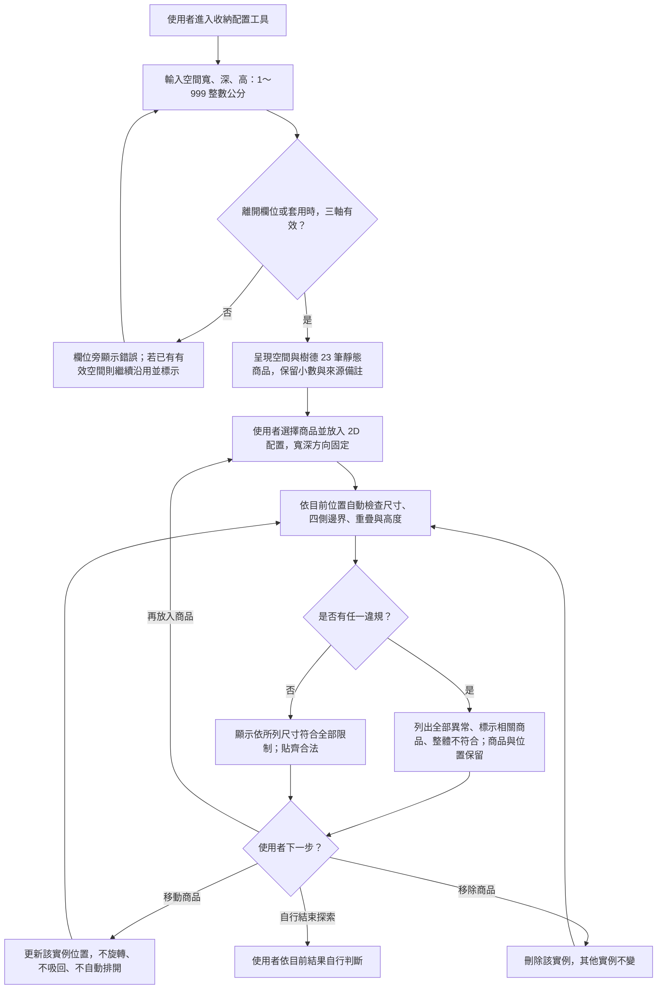

# Design｜MVP 核心配置功能

## Context

動機見 [proposal.md](proposal.md)。目前只有需求、靜態商品 JSON 與 OpenSpec 文件，沒有應用程式、套件設定或測試可沿用；正式 specs 也尚空白。本次需設計跨表單、目錄、互動配置與純檢查邏輯的前端架構，因此建立此文件。

商品 JSON 的 `width`／`depth`／`height` 已為公分，含 `37.05`、`18.55` 等小數；不可再次將它們當 mm 換算。資料內含 `id`、`sourceUrl`、`note`、`image`、`stackable`；`image` 用於商品圖片（D08），`stackable` 不衍生功能。資料內容以本地檔案為準，本次未重新查證官網或圖片授權。

## Goals / Non-Goals

**Goals：**

- 將商品、配置實例、空間與檢查結果分離，讓旋轉等未來變更可明確修改規格而不污染目前方向。
- 所有判定使用同一份當前狀態及精確尺寸，畫面縮放不改變真實尺寸與判定。
- 先固定可觀察契約與驗證資料；AC07、AC08 依 proposal「審查決策」實作。

**Non-Goals：**

- 不建置伺服器狀態、遠端資料存取、幾何推薦引擎或 3D／堆疊模型。
- 不做跨裝置同步、全部清空按鈕或空配置的成功文案。

## Operation Flow

入口為使用者進入 `/`；商品資料已通過必要結構檢查，若瀏覽器本機有有效的保存配置則先恢復。使用者自行停止操作即可，不要求「完成配置」按鈕。

| 分支 | 對應 spec scenario／驗收依據 |
|---|---|
| 無效設定 → 修正 | `space-settings`「拒絕無效數值」「輸入中不提示、離開欄位才提示」「無效修改不影響現有配置」；AC07 |
| 移除 → 自動重檢 | `layout-editing`「移除一件商品」「移除造成重疊的商品即解除重疊」 |
| 正常放入 → 全部符合 | `layout-validation`「正常配置符合限制」「四側貼齊合法」「共邊與共角合法」；AC01 |
| 任一違規 → 不符合且保留 | 「任一側越界」「不同實例重疊」「高度超限」及 `layout-editing` 保留行為；AC02～AC04 |
| 調整 → 自動重檢 | 「新增與移動自動檢查」「移動解除衝突」；AC05～AC06 |
| 多項中仍有一項違規 → 不符合 | 「多重異常不能被單項通過覆蓋」「部分解除仍不符合」「多種異常同時列出」「部分解除後只留剩餘異常」；R06、AC08 |

流程結構已檢查：決策邊均有標籤、各路徑到達結果或明確的調整迴圈。未找到本機 `mmdc`，因此尚未驗證 Mermaid 渲染；未使用線上渲染服務。

## Decisions

### D01｜純前端模組與資料界線

依 `openspec/config.yaml` 使用 React、Vite、TypeScript strict、npm、React Router、Tailwind CSS、Zod，設定 ESLint／Prettier；這是現有專案約束。入口路由設計為 `/`，不額外新增導頁。

建議檔案分工（皆為待實作路徑）：

| 模組 | 職責 |
|---|---|
| `src/domain/` | 商品／空間／實例型別、精確尺寸轉換、無 UI 副作用的驗證器 |
| `src/data/` | 靜態匯入既有 JSON，驗證並轉接為 domain 商品；不複製第二份目錄 |
| `src/features/space/` | 字串輸入草稿、驗證時機與有效空間的邊界 |
| `src/features/catalog/` | 商品目錄、尺寸、來源、備註與放入動作 |
| `src/features/layout/` | SVG 與 Pointer Events、實例狀態、座標轉換 |
| `src/features/validation/` | 檢查摘要、異常明細與商品標示 |
| `tests/geometry/` | 不啟動瀏覽器的 Playwright Test domain 測試、40 筆品質 fixtures |
| `tests/e2e/` | 自動化瀏覽器測試；MCP 另依自然語言清單驗證 |

本地 reducer 統一處理空間與配置異動（放入、移動、移除、套用空間），檢查結果由當前有效狀態衍生，避免雙份狀態不同步。相比外部狀態套件，這個規模不需額外依賴；也不以後端維護狀態。保存方式見 D08。

### D02｜商品與配置實例分離

`Product` 沿用既有商品 ID、名稱、寬／深／高、來源與備註，視為不可變；`Placement` 包含獨立 `instanceId`、`productId` 與 `x`／`y`，不存旋轉角度或複製可變商品尺寸。同型商品可有多件實例，碰撞以實例身分而非商品 ID 去重。

對照方案是在商品資料直接寫位置，但會使同款多件互相覆蓋，因此不採用。正常 JSON 路徑以 Zod 確認 ID 唯一、尺寸為正的有限值及必要欄位完整；若資料結構損毀，不得以 0 或省略未知商品後宣告整體符合。本機保存資料的損毀處理依 D08：忽略該筆資料、以空白狀態開始並提示，不自行補值。

### D03｜空間方向與精度

空間與商品統一使用寬、深、高：介面標籤為「寬（左右，cm）」、「深（前後，cm）」、「高（cm）」，商品寬對應空間寬、商品深對應空間深，不需另外說明映射。原稿依 sdd-input 使用「長、寬」，審查時改名以避免混淆（proposal 追加 4）。

空間輸入以字串草稿保存，離開欄位或按「套用空間」時才驗證：去除前後空白後須符合 `^[0-9]+$` 且數值在 1～999。驗證失敗只顯示欄位錯誤，有效空間維持上一次的值並標示「仍使用上一次的有效空間」；三軸都有效且按下套用時才更新有效空間。以字串規則驗證可避免 `1e2`、`1.0` 被瀏覽器數字欄位轉成合法整數。

左上角為原點，x 向右、y 向後；商品使用軸對齊矩形，寬與深固定。渲染像素只負責顯示，不直接作為尺寸檢查輸入。

採整數定點表示：從商品 JSON 的十進位精度決定倍率（目前最多兩位，倍率 100，即 0.01 cm）。以十進位字串精確轉換原始數值，不直接依賴 `37.05 * 100` 的二進位結果；拖曳座標轉換為相同最小刻度後儲存，尺寸本身不捨入。所有尺寸、座標、邊界相加與比較須處於安全整數範圍；超出能力時不得誤判符合。空間上限 999 公分換算後為 99,900，遠低於安全整數範圍。

不採寬鬆 epsilon：它可能讓確實超出 0.01 cm 的配置通過。也不把商品尺寸取整，避免資料與判定不一致。若未來資料精度提高，必須同步擴大倍率並驗證安全範圍，不能悄悄捨去新小數。

### D04｜純檢查器與整體判定

檢查器輸入為有效空間、商品索引與 placements；結果含每件尺寸／越界（含方向）／高度資訊，以及每對重疊實例。畫面依 AC08 決策：同時列出全部異常、依放入順序排列、重疊列出兩件商品，有異常的實例在 SVG 上加醒目樣式與文字標記；明細由最新檢查結果直接產生，因此已解除的異常會自然消失。

- 尺寸超限：商品 width 大於空間寬度，或 depth 大於空間深度，或 height 大於空間高度。
- 越界：`x < 0`、`y < 0`、`x + width > spaceX`、`y + depth > spaceY`；相等合法。
- 重疊：對每個不同實例配對一次，兩軸均須嚴格相交：`a.x < b.x + b.width && a.x + a.width > b.x`，y 軸同理；共邊／共角不算重疊。
- 高度：`height > spaceHeight` 才超限；所有物件均落在同一平面，不依 `stackable` 推論堆疊。
- 整體：僅在有效輸入且所有已放入商品檢查都通過時，才可能產生符合狀態。任何錯誤／未知資料均不能回傳成功。尚未設定空間為待設定，不顯示符合；空配置的具體文案留待介面審查，不增加驗收要求。

每次新增或移動都計算最新結果，禁止只以最後一個檢查的布林值覆蓋前面失敗。採簡單配對 O(n²)，目前商品目錄有限而配置件數未設產品上限；先求正確，若實測拖曳效能不足，再以 profiling 決定是否最佳化，不先加空間索引。

### D05｜SVG 互動與不強制修正

採 SVG 呈現空間邊框與商品矩形，Pointer Events 捕捉拖曳，在拖曳過程及放開時以最新座標更新配置與判定。新增先放在原點（操作起點的設計選擇，不是最佳配置）；可重疊或越界，使用者再移動。相較 canvas，SVG 較便於個別實例的語意與測試定位；目前不需大型拖曳套件。

拖曳跨邊界仍保留目標位置，不 clamp、不自動轉向、不自動排開、不回滾。畫布留出可操作的邊界外區域，使用 pointer capture 讓游標跨空間邊界仍完成拖曳；顯示範圍與內容範圍分離，使越界商品仍可看見並移回，不以 `overflow: hidden` 永久藏掉。

SVG 變換須包含 viewBox 比例、畫布偏移、留白與捲動。保留商品標籤／實例識別，讓重疊物件可辨識。所有警示以文字搭配視覺狀態呈現；只顯示顏色不足以驗證類型。

每個已放入的實例提供「移除」按鈕（在實例清單或選取後顯示），移除只刪除該 `instanceId`，其他實例不變。

### D06｜可觀察 UI 與測試契約

介面契約：空間欄位使用 D03 的 label，以「套用空間」提交有效尺寸，商品以原始名稱辨識，放入動作「放入配置」，移除動作「移除」，圖面名稱「收納配置區」，整體結果「配置檢查結果」，異常清單「異常明細」；符合文案包含「依所列尺寸，符合全部限制」，不符合文案包含「不符合全部限制」，沿用舊空間時顯示「仍使用上一次的有效空間」。保留 JSON 備註，使尺寸外徑不明可被使用者辨識。

可對配置實例提供穩定 `data-testid`，測試以可見名稱或角色優先。精確小數接觸與 0.01 cm 邊界由 domain 固定案例驗證，避免要求使用者／MCP 以滑鼠精準命中百分之一公分；MCP 仍驗證拖曳與結果整合。

### D07｜測試與決策界線

沿用專案規定 Playwright：同一 Test runner 建立 `geometry`（無瀏覽器 fixture）與 `e2e` project，不另外引入單元測試框架。命令設計為 `npm run test:geometry`、`npm run test:e2e`；實作時補至 `package.json` 與 README。

40 筆固定品質案例須先有獨立標準答案，再測判定器，包含 20 筆符合與 20 筆不符合。測試資料、預期值與實際結果分開保存；不能由待測函式產生預期值。端對端執行結果與證據見 [e2e-testing.md](e2e-testing.md)。

### D08｜本機保存與商品圖片

**保存**：以 `localStorage` 保存有效空間與 placements（`instanceId`、`productId`、`x`、`y`），每次異動後寫入，載入時以 Zod 驗證；格式錯誤、指向不存在的商品或讀寫失敗（例如瀏覽器禁止儲存）時忽略保存資料、以空白狀態開始，並在畫面上提示無法保存。替代方案 `sessionStorage` 關閉分頁就消失，不符合使用者「誤觸也不要消失」的需求；後端保存超出 MVP 範圍。

**圖片**：直接使用 JSON 的官網圖片網址，不下載進專案；`` 載入失敗時換成替代圖示。頁面底部與 README 加上「本專案為課程作業練習，商品資料與圖片版權屬樹德」。外部圖片可能因官網改版或防盜連結失效，因此 E2E 不以官網圖片成功載入作為通過條件，只驗證有圖或有替代圖示。

## Risks / Trade-offs

- **來源不一定是外部最大尺寸** → 顯示既有備註及「依所列尺寸」的判定依據；不宣稱實物保證，不擅自刪商品。
- **渲染比例或定點轉換導致誤判** → 以精確 domain 案例與拖曳整合分層驗證；尺寸保持原資料，畫面比例不進入幾何規則。
- **自由越界導致商品難以取回** → 保留邊界外顯示與操作範圍，驗證可拖回。
- **保存資料與新版程式不相容** → 載入時驗證，不相容就忽略並從空白開始，不嘗試修補。
- **官網圖片失效** → 替代圖示，不影響檢查；版權以作業練習聲明處理，未取得授權。

## Migration Plan

此為初版建置，沒有既有使用者資料或正式規格需要搬移。實作時新增前端與測試，保留商品 JSON、`sdd-input.md` 及本次決策對照。部署環境尚未指定，不在本次承諾發布；以本機啟動及 production build 驗證。若需回復，撤回本次應用程式變更即可，不涉及資料庫 migration。

## 產品決策的承接

AC07、AC08 與追加的移除、圖片、保存、軸名稱，已於 2026-11-09 審查時由使用者決定，見 proposal.md「審查決策」。本文件 D03、D04、D05、D06、D08 已同步。
